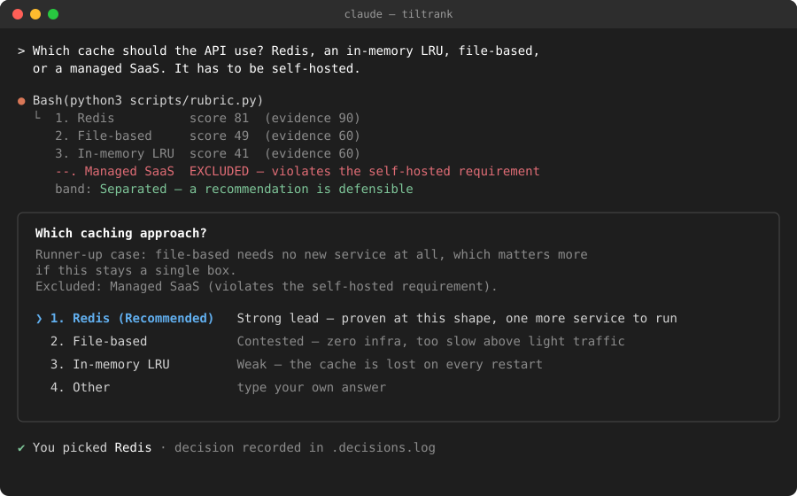
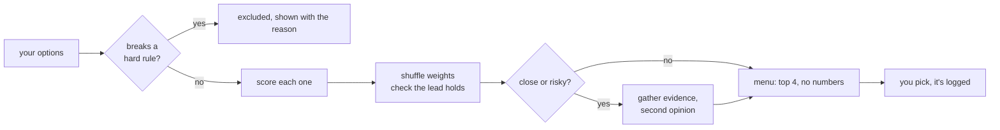

# tiltrank

**Give your AI agent a few options. It scores them openly, drops the ones that break your rules, and lets you make the final pick from a menu.**

The name comes from the stability check: tiltrank tilts the weights a few hundred times and reports whether the top pick still wins.

Works as a skill in **Claude Code**, **Hermes Agent**, and **pi**. Pure Python, no dependencies.

<p align="center">
  
</p>

[](https://github.com/tomkabel/tiltrank/actions/workflows/test.yml)
[](https://www.python.org/downloads/)
[](#requirements)
[](https://docs.claude.com/en/docs/claude-code/skills)
[](https://hermes-agent.nousresearch.com/docs)
[](https://github.com/badlogic/pi-mono)
[](https://agentskills.io/)

## The problem

Ask an agent "which of these four should I use?" and you get one confident
paragraph. You can't tell what it weighed, whether the runner-up lost by a mile
or a hair, or whether it checked anything first.

## What tiltrank does instead

1. **Drops options that break a hard rule.** "Must be self-hosted" takes out the
   SaaS option before any scoring, and the menu tells you it was removed and why.
2. **Scores the rest against fixed descriptions** (fit, reversibility, how proven
   it is), so a score means the same thing every time.
3. **Checks whether the winner really wins.** It shuffles the weights and ratings
   a few hundred times, and swaps in the runner-up's rating one criterion at a
   time. If the leader changes either way, it says the call is contested and
   names the rating the lead rests on.
4. **Refuses to rank without context.** If nothing you stated separates the
   survivors, the band is *Undetermined* and the agent asks up to three closed
   questions first. Every requirement it then scores against is quoted from you
   or from a file it read; the eval checks that.
5. **Asks you.** You get a normal menu in your agent's own UI: the top pick
   marked *(Recommended)*, the rating the lead rests on, and an *Other* option.
   Your pick wins, it gets logged, and a high-stakes decision gets an ADR under
   `docs/decisions/`.

You never see percentages or "82/100". Those numbers are utility scores, not
probabilities, and people read too much into them. The menu shows plain labels
like *Strong lead*, *Contested*, and *Weak*.

## Quick start

One command installs the skill for Claude Code, Hermes Agent, and pi.
The copies are independent of this repo. An edit here does not change an
installed copy, and a local edit does not update anyone else's install.

```bash
npx skills add tomkabel/tiltrank --skill tiltrank -g -a claude-code hermes-agent pi --copy -y
```

The same flags remove it. `-g` and `-a` are required: without them, `skills remove` looks in the current project and leaves the global copies in place.

```bash
npx skills remove tiltrank -g -a claude-code hermes-agent pi -y
```

Updates use the same global scope: `npx skills update -g`.

That's the install. Then ask your agent to choose between some options:

> Pick a queue for the job runner: Redis streams, RabbitMQ, or Postgres `SKIP LOCKED`. We can't add new infra.

The skill triggers by itself. You can also call it with `/tiltrank`.
`/panel` is a pi extension command, not a Claude Code or Hermes command.
Use it only after the pi extension is installed.

The command writes the skills CLI's own lockfile under `~/.agents/`.
Pin the CLI, or the next release can change the flags:

```bash
npx skills@1.7.4 add tomkabel/tiltrank --skill tiltrank -g -a claude-code hermes-agent pi --copy -y
```

1.7.4 was still the npm `latest` tag on 2026-11-01. It has no version flag of its own. Read that lockfile before you call this reproducible. Do not run it if you cannot accept a write to that file. Set `DISABLE_TELEMETRY=1` to skip the CLI's usage report.

Claude Code can also install from this repo's own marketplace, which is not
Anthropic's marketplace. The marketplace file has to be on the default branch
first. Then run `claude plugin marketplace add tomkabel/tiltrank` and
`/plugin install tiltrank --marketplace tomkabel/tiltrank`.

### If the command fails

Hermes, only if you did not use the `npx` command above: add `~/.agents/skills`
to `skills.external_dirs` by editing the list. Do not assign that key with
`hermes config set`. That replaces every entry, and a path that does not exist
is skipped with no error, so a typo looks like a successful install that did
nothing. If you previously registered this clone in that list, remove that
entry. Hermes loads `~/.hermes/skills/` before `external_dirs`, so a copied
install is what loads; leaving the clone entry in place does not keep the repo
as the source.

pi's extension is a separate install, and this repo is not on the pi package
registry. `pi install` of this repo's root is the wrong directory. The pi
extension lives in `extensions/`. pi on this machine did not run on 2026-11-01
(`pi --version` exits `MODULE_NOT_FOUND`). The skills CLI's `pi` agent copies
into `~/.agents/skills/`, not `~/.pi/agent/skills/`. The three-segment link
below is the discovery path this repo verified. It was not re-checked against
a live pi.

Maintainer checkout, if you are editing this repo rather than installing a
release:

```bash
git clone https://github.com/tomkabel/tiltrank.git
cd tiltrank
mkdir -p ~/.agents/skills
ln -sfn "$PWD/.claude/skills/tiltrank" ~/.agents/skills/tiltrank
ln -sfn ../../.agents/skills/tiltrank ~/.claude/skills/tiltrank
ln -sfn ../../../.agents/skills/tiltrank ~/.pi/agent/skills/tiltrank
```

The pi link has three `..` segments. A two-segment relative link does not
resolve. Details: [`docs/porting-hermes-pi.md`](docs/porting-hermes-pi.md).

### Requirements

- Python 3.10 or newer, standard library only. No packages, no virtualenv. CI
  rejects any non-stdlib import.
- Claude Code, Hermes Agent, or pi to show the menu.

## How it decides



### The scorecard

| criterion | weight | question it answers |
|---|---:|---|
| `fit_to_constraints` | 0.50 | Does it do what you asked, within your limits? |
| `reversibility` | 0.30 | How painful is it to undo? |
| `precedent` | 0.20 | Has this been done before for this kind of problem? |
| `evidence` | not weighted | Did the agent check this, or is it from memory? Weak evidence triggers a review instead of changing the score. |

Each score has to be one of three levels: `90`, `60`, or `20`. Values like `87`
are rejected because three written descriptions can't support that much
precision. An unknown (`null`) counts as zero, so an option can't win by never
being checked.

<details>
<summary><b>What each level means</b></summary>

<br>

| | `90` | `60` | `20` |
|---|---|---|---|
| **fit_to_constraints** | meets every stated need | meets the main need, misses a preference | misses a need, or the need is a guess |
| **reversibility** | config flag or one revert commit | scripted rollback, no data loss | data migration, destructive, or already user-visible |
| **precedent** | widely used for exactly this | used for similar problems or at another scale | new, or the known cases differ |
| **evidence** | verified in this repo this session | official docs or a named precedent | remembered from training, not checked |

</details>

### When it asks for a second look

| signal | meaning | what the agent does |
|---|---|---|
| `not-separable` | the lead flips when weights shift | reviews, or tells you it's a coin flip |
| `weak-field` | every option is poor | reconsiders the question; maybe none of these |
| `unverified-evidence` | the top pick was never checked | runs a test, grep, or doc lookup |
| `no-feasible-option` | everything breaks a hard rule | asks you to relax a rule |

The second look has to bring in new information, such as a tool call that could
prove the top pick wrong. The same model arguing with itself four times doesn't
count.

## Run the scorer yourself

The agent normally calls this script for you. To run it by hand:

```bash
python3 .claude/skills/tiltrank/scripts/rubric.py <<'JSON'
{"choices": [
  {"label": "Redis",         "evidence": 90, "scores": {"fit_to_constraints": 90, "reversibility": 60, "precedent": 90}},
  {"label": "In-memory LRU", "evidence": 60, "scores": {"fit_to_constraints": 20, "reversibility": 90, "precedent": 20}},
  {"label": "Managed SaaS",  "feasible": false, "note": "violates the self-hosted requirement"}
]}
JSON
```

```console
tiltrank: 2 ranked · 1 excluded (Managed SaaS) · Separated
1. Redis  fit high · reversibility med · precedent high · evidence high
2. In-memory LRU  fit low · reversibility high · precedent low · evidence med
--. Managed SaaS  EXCLUDED — violates the self-hosted requirement

lead holds on every single rating
separation: robust — how often this option stays on top under resampled weights and one-band rating noise
band: Separated
separated: yes — a recommendation is defensible
NOTE: levels are anchor bands, not a confidence. Quote the band and the `lead rests on` line to the user; pass --table or --json for numbers.
```

The default output has no totals: Claude Code shows this text to you, and a
weighted sum next to a label reads as precision the three-level inputs do not
have. `--table` prints the totals and bounds, `--json` is for tooling, and
`--log` appends the decision to `.decisions.log` (or `$TILTRANK_LOG`). Each
record holds the question, the requirements, the weights, every level, the
verdict, your pick, and whether you overrode the recommendation.

The `lead rests on` line is a deterministic probe: give the top option the
runner-up's rating on one criterion at a time. If any single swap flips the
order, the call is `Contested`, whatever the resampling said, and the line names
the rating the lead depends on.

## Testing

```bash
S=.claude/skills/tiltrank/scripts
python3 $S/test_rubric.py          # scoring, gating, validation
python3 $S/eval/check_trace.py     # agent-behaviour checks on recorded traces
python3 $S/eval/check_trace.py --live --driver claude --model claude-sonnet-5-5 --repeat 3   # real sessions, costs tokens
```

A skill is a prompt, so the main risk is the agent not following it.
`check_trace.py` fails a trace if the agent:

- offers more than 4 options, or offers an excluded one
- shows a score-like number (`82%`, `82/100`, `0.82`, "confidence"), passes
  `--json` on Claude Code, or repeats a logged total in its reply
- marks the wrong option *(Recommended)*
- skips a required review, or re-scores to make a warning go away
- runs an *Other* answer that looks like an injected command
- acts on anything other than your pick

Every rule has a deliberately broken example in `fixtures.json` that must fail.

<details>
<summary><b>Live eval results and limits</b></summary>

<br>

The offline suite runs in CI. A full live pass on Hermes (15 scenarios × 3
repeats, 2026-09-21) broke protocol in 17.8% of runs (95% CI 9.3–31.3%), above
the 10% gate. These are genuine model deviations, not harness bugs. On Claude
(`claude-sonnet-5-5`, Claude Code 2.1.319, 2026-11-10), all 45 runs invoked the
rubric and 17.8% broke protocol (95% CI 9.3–31.3%), also above the gate. Six of
those nine breaks come from a checker bug
([#21](https://github.com/tomkabel/tiltrank/issues/21)); without it the same
runs score 6.7% (95% CI 2.3–17.9%), still above the gate. See
[PLAN.md](PLAN.md).

Headless `claude -p` has no `AskUserQuestion` tool, so menu contents in live runs
are self-reported by the agent. Scores, gating, and verdicts come from the
script's own log and are ground truth.

The first live run caught the agent bumping an evidence score to make the
`unverified-evidence` warning disappear. That's now a test (`RESCORE_TO_DISMISS`)
and an explicit rule in `SKILL.md`.

</details>

<details>
<summary><b>Design decisions</b></summary>

<br>

| decision | why |
|---|---|
| Rank on the conservative bound | Filling unknowns with the average let an all-unknown option outrank a fully checked one. |
| Only three score levels | Three descriptions can't justify 100 levels; the extra precision was noise. |
| `evidence` kept out of the score | Researching an option doesn't make it better. |
| Measured stability instead of a fixed margin | The old margin was a guess, and it decided when to escalate. |
| No numbers shown to user or agent | A number the agent sees tends to end up in the menu. |

The design came from three review rounds, including an adversarial review by
five models from different families ([`docs/review-2026-09-04/`](docs/review-2026-09-04/)).
The net result was deleting two of the three original scripts.

</details>

## Project layout

```
.claude/skills/tiltrank/
├── SKILL.md              the workflow the agent follows (the actual product)
└── scripts/
    ├── rubric.py         scoring, rule gating, stability, decision log
    ├── test_rubric.py    unit tests
    └── eval/
        ├── check_trace.py   behaviour checks + live harness + --benchmark
        ├── fixtures.json    recorded traces, including broken ones
        ├── scenarios.json   dev-set scenarios for --live runs
        ├── benchmark.json   held-out benchmark key (frozen; nobody tunes against it)
        └── baseline.json    benchmark results on the pre-0.4.0 engine
docs/demo/               hero payloads, renderer and its contract test
extensions/tiltrank.ts   pi menu tool and /panel
```

## Contributing

Issues and PRs welcome. Two rules:

1. **New behaviour needs a fixture**, including a broken trace that must fail.
2. **No dependencies.**

Run both test suites and `claude plugin validate .claude/skills` before opening a
PR. See [CONTRIBUTING.md](CONTRIBUTING.md), [CHANGELOG.md](CHANGELOG.md), and
[PLAN.md](PLAN.md) for design history.

## License

[Mozilla Public License 2.0](LICENSE) (MPL-2.0). Copyright © 2026 Tom Kristian Abel (ProksiAbel OÜ).

MPL-2.0 is file-level copyleft: you can bundle tiltrank into any project, open or proprietary, but changes to tiltrank's own files must stay under MPL-2.0. Copies obtained while the project was MIT-licensed keep their MIT terms.
